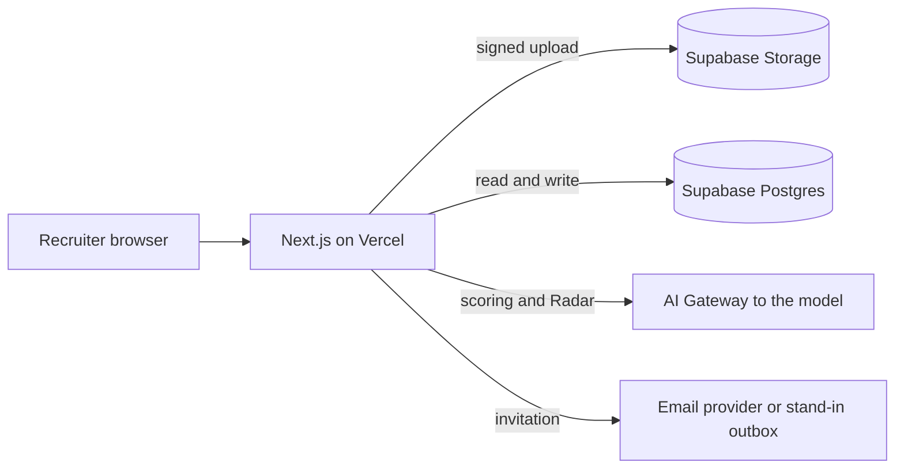

# Talent Gateway

AI resume screening with a person in charge. Recruiters paste a job description and drop in a batch of resumes. A rule-based check sets aside unreadable files, an AI scores and explains the rest, and the recruiter decides who gets invited. One click sends the interview invitation by email.

**Status:** the full flow is built and deployed: sign-in, jobs, resume upload and download, the ATS check, AI scoring and Radar, the ranked list and the invitation email. Sections marked "planned" or "draft" are not built yet.

- Repository: https://github.com/RajaChaiban/Talent-Gateway
- Demo URL: https://talentgateway.dev (also https://talent-gateway-gamma.vercel.app)

## The problem

A recruiter for a busy role gets hundreds of resumes as PDFs and Word files. Reading them all takes hours. Some files are scans or are damaged and contain no text. Scoring by eye is inconsistent from one reader to the next. And an automated tool that contacts candidates on its own is a risk nobody wants to own.

Talent Gateway removes the slow, repetitive part (checking files and a first read) and keeps the decision with a person.

## How it works

1. **Create a job.** Title, the pasted job description and two score thresholds (top talent and invite bar).
2. **Upload resumes.** PDF or DOCX, up to 5 MB each, up to 20 files at a time and 50 per job. Files go straight to storage, and each uploaded file can be downloaded again from its row.
3. **Pre-screen.** A rule-based check reads each file's text. A scanned image, a damaged file, a resume with no email address, no phone number or a picture in it, or one that falls below the pass score (for example with too few standard sections) is set aside on a "Not ATS-ready" tab with the reason. No model is called for it, so no money is spent on it.
4. **Score.** For every readable resume the AI returns a match score from 0.0 to 10.0, a short summary, strengths and gaps.
5. **Radar.** The AI also flags four risks: copied text, employment gaps, frequent job changes and AI-written padding. Each flag carries a one-line note.
6. **Rank.** Candidates appear best first on three tabs: Ranked, Not ATS-ready and Queued. Each ranked candidate shows the score in green, amber or red with a word beside it (Strong, Possible or Weak match), and a search box filters the list by name. The recruiter can override the check with "Score anyway" for a file that was set aside.
7. **Decide and invite.** Every ranked candidate has an **Invite to interview** button. It opens the candidate with the email address read from the resume, which the recruiter checks or corrects and then confirms. That confirmation is the approval. An email goes to the candidate, and the candidate's status changes to Invited.

### Human in the loop

The AI recommends and a person approves. Nothing is sent to a candidate without a recruiter's click, and every invitation records who approved it and when.

| Score | Colour | Meaning |
|---|---|---|
| 8.0 and above | Green | Top talent (default threshold, adjustable per job) |
| 5.0 to 7.9 | Amber | Worth a look; invite bar defaults to 7.0 |
| Below 5.0 | Red | Unlikely match |

Thresholds only suggest who to look at first. They never send anything.

## Architecture

Status: built, except Workflow, which is planned. Today the browser calls one short route handler per resume, and the invitation is sent inside the request that approves it.



### Vercel building blocks (planned)

| Piece | Role | Why |
|---|---|---|
| Next.js on Vercel | The recruiter pages and route handlers | One deployment for UI and API; the landing page stays static |
| AI SDK | Structured model calls: score, summary, strengths, gaps, Radar | Typed output checked against a schema, with one retry when the model's output does not parse |
| AI Gateway | Routes model calls and holds the credentials | No provider keys in the app; one place for model choice, limits and cost tracking |
| Workflow (planned) | Would run the batch analysis and the invitation durably | Retries a failed step and survives a closed tab or a redeploy. Until then the job's status is derived from the saved rows, so an interrupted run is picked up by the next one, and each invitation is sent at most once |

### What stays outside Vercel

| Piece | Why it stays |
|---|---|
| Supabase (Postgres, Auth, Storage) | It is the system of record: the recruiter's jobs, resumes and candidates. In this project it stands in for the customer's existing applicant system, and Vercel connects to it rather than replacing it |
| Email delivery | A mail provider (or, in the demo, a stand-in outbox) owns deliverability and sender reputation. Vercel does not send mail |

## Data model

See [docs/DATA_MODELING.md](docs/DATA_MODELING.md): four tables (jobs, resumes, candidates, invitations) and one private storage bucket, applied to the hosted database.

## Backend contract

See [docs/BACKEND.md](docs/BACKEND.md). It lists every route, environment variable, model call and error code, and `npm run docs:check` fails when it disagrees with the code.

## Rollout plan

Status: draft.

1. **Pilot.** One recruiter, one open role, a past batch of resumes. Compare the ranking with the recruiter's own shortlist.
2. **Shadow.** Run beside the current process for two weeks. Recruiters still read everything; the tool only scores.
3. **Guided use.** The recruiter starts from the ranked list and sends invitations with the click.
4. **Wider rollout.** More roles and teams, with the thresholds tuned per role.

## Success measures

Status: draft.

- Time from the last resume received to a shortlist.
- Agreement between the AI's top candidates and the recruiter's final shortlist.
- Share of AI suggestions a recruiter overrides, and which way.
- Share of unreadable files caught before a recruiter opens them.
- Cost per resume scored.

## Known limitations

- Sample candidates on the landing page are invented.
- Any picture in a resume sets it aside: the check cannot tell a photo from a logo, and a recruiter can override it with "Score anyway".
- Scores are a first filter. They have not been checked against real hiring outcomes or for bias.
- Scanned resumes are set aside, not read by OCR.
- Invitation emails are sent from the product's own domain to the address the recruiter approves. The sender address has no inbox, so a candidate's reply is not received.
- Single demo tenant: every signed-in user sees every job.

## Development tooling

- **Quality gate.** `npm run lint`, `npm run docs:check`, `npm run typecheck`, `npm run test`, `npm run design:contrast` and `npm run build`. CI runs the same commands in the same order on every pull request.
- **Docs as a verifier.** `docs/BACKEND.md` must name every route, environment variable, model and error code, and CI fails when it does not.
- **Contrast check.** Every color pair in the design tokens must meet WCAG AA in both themes.
- **Agent instructions.** `AGENTS.md` holds the working rules, review loops and delivery workflow used on this repository.
- **Delivery.** One feature per branch and one pull request per feature.

### How AI behaviour was validated

The full record, with every run's report, is in [docs/EVALUATION.md](docs/EVALUATION.md). In short, five layers:

1. **Schema.** Model output must match a schema; output that does not parse is retried once and then fails the resume instead of being guessed.
2. **Unit tests against a stand-in model.** The pipeline, the score arithmetic and the "no model call for a set-aside resume" rule are proven in CI without network access.
3. **An evaluation set on the real model** (`npm run eval`). Eight tests state what should happen before the model runs: real files through extraction and the ATS check, role match, one factor changed at a time, stability over three runs, a resume that asks for a score of 100, a strict and a loose job description, the recruiter's score bars, and five job types with five resumes each. A run writes a dated report and fails when a pass mark is missed.
4. **A larger model as a reference.** The same prompt and the same 25 cases were run on a much larger model and compared score by score: the same role match on every case both scored, an average difference of 0.24 on the 10 scale, at about 46 times the cost and twice the time. That is the evidence for using the small model.
5. **A blind check on the live site.** Ten new resumes over two jobs were scored first by an independent reviewer model, then uploaded to the deployed site by a separate browser agent that recorded what the platform said, and the two were compared. The pre-screen agreed on 10 of 10, 7 of 9 scores were within 0.3, and an invitation sent from the site was delivered.

What the tests changed: the model stopped doing arithmetic. It now judges each must-have of the job description, and the code adds up the score, because the evaluation showed the model did not follow scoring rules written in the prompt. Every attempt, including the ones that failed, is kept in `docs/evals/`.

What they do not prove is stated in the same document: the bands are the author's judgement, the set is a regression check and not a benchmark, and nothing here measures fairness.

## Try it

A reviewer can try the whole flow in a minute with the sample files. Every person, employer and school in them is invented.

1. Sign in with the demo account in the submission notes.
2. Create a job. On the new job form, open "Use a sample job description" (`/samples/sample-job-description.txt`), copy it into the description and give the job a title.
3. On the job page, click "Download sample resumes" under the drop zone, unzip the file and drop the seven PDFs in.
4. Click **Analyze** and open the Ranked and Not ATS-ready tabs.
5. To try an invitation, click **Invite to interview** on a candidate, replace the made-up address with your own and confirm. The email arrives from `hiring@talentgateway.dev`.

What to expect for each file:

| File | What it shows |
|---|---|
| `1-strong-match.pdf` | A strong match: ready, scored high |
| `2-good-match-other-stack.pdf` | A good match on another stack (Angular and Java): ready, scored in the middle |
| `3-vague-claims.pdf` | The right skills with vague claims and no numbers: ready, scored lower than file 1 |
| `4-related-role.pdf` | A QA automation engineer, a related role: ready, scored low to middle |
| `5-unrelated-role.pdf` | A product manager: ready, scored low |
| `6-no-email-no-phone.pdf` | The strong resume without an email address or phone number: set aside as Not ATS-ready, no model call |
| `7-with-photo.pdf` | A European-style CV with a portrait: set aside as Not ATS-ready for the picture; "Score anyway" overrides it |

The files are static and public: they live in `public/samples/` and are served at `/samples/`.

## Run it locally

```bash
npm install
npm run dev
```

Open http://localhost:3000. The landing page needs no environment variables. Everything behind sign-in needs the variables listed in `docs/BACKEND.md`, in `.env.local`.
