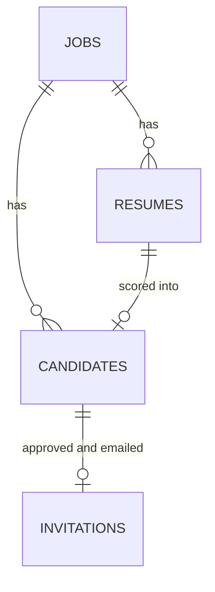
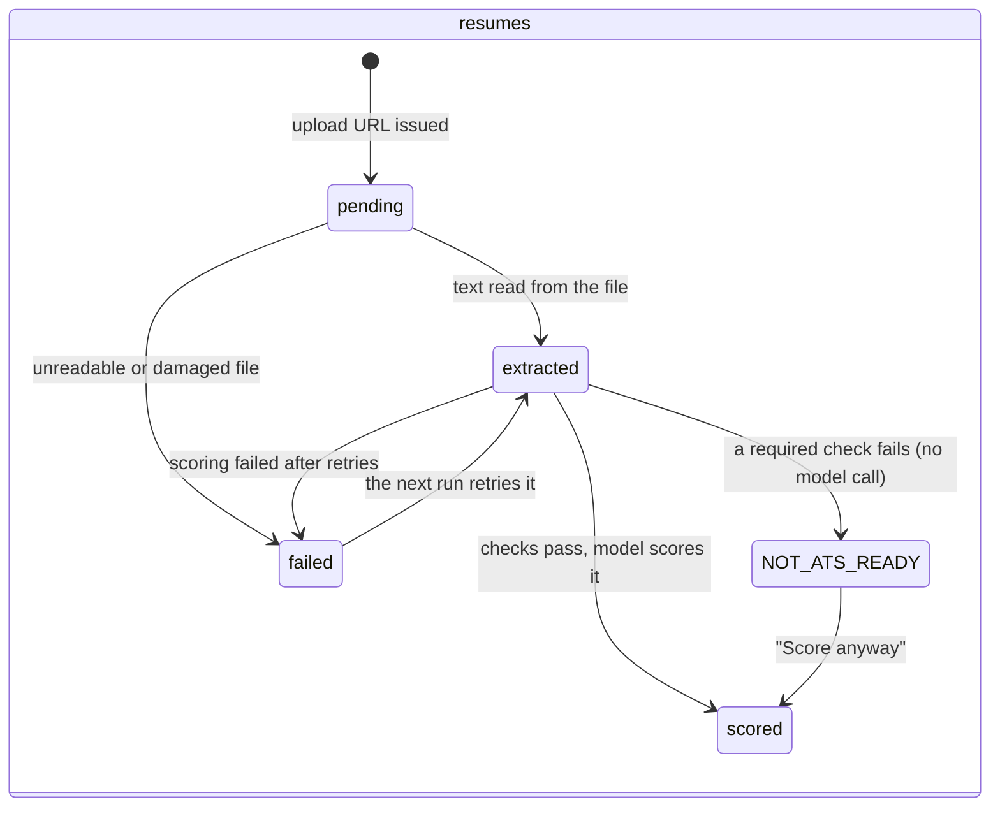
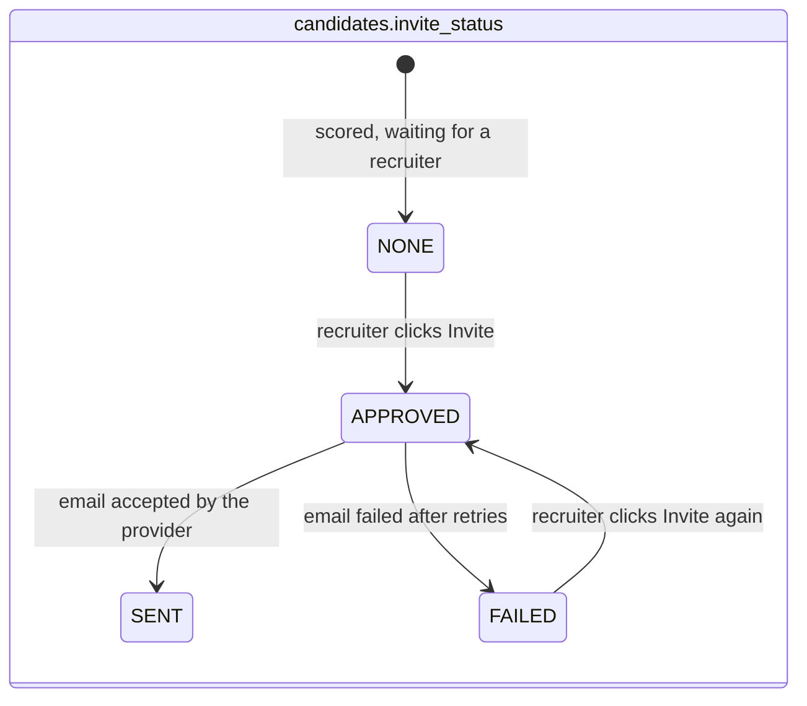

# DATA_MODELING.md — schema, rules and storage

The data model for talent-gateway on Supabase Postgres: four tables, one storage bucket, a single demo tenant. How the server uses these tables is in [BACKEND.md](BACKEND.md).

**Status: applied.** The hosted database matches this file. Three migrations in `supabase/migrations/` build it: `create_core_tables`, then `invite_flow`, which removed the automated interview tables and added `invitations`, then `job_status`, which stores the state of a job's analysis run again. The app reads `jobs` and a resume count per job (the list on `/app`), inserts into `jobs` (the create-job form) and updates their thresholds (the job page). On the job page it also writes `resumes` and the `resumes` Storage bucket: the upload inserts a `pending` row, the browser stores the file, the server sets `extracted_text` and `status` (`extracted` or `failed`), and removing a resume deletes its file and then its row. The screening routes write the rest of the pipeline: `resumes.ats_status`, `ats_score` and `ats_reasons` (the ATS check), `resumes.ats_override` ("Score anyway"), `resumes.status` (`failed` when the analysis fails, back to `extracted` when it is retried), one `candidates` row per scored resume (always `invite_status = 'NONE'`, with `email` read from the resume), and `jobs.status` (the state of the analysis run). `run_id` is left at its default and `invitations` is not written yet. The `scored` value of `resumes.status` is allowed by the check constraint but never written: a resume counts as scored when it has a `candidates` row.

Supabase plays the customer's existing system here: the system of record that the Vercel pieces connect to rather than replace.

## 1. Entity relationships



| Relationship | Cardinality | Meaning |
|---|---|---|
| job → resumes | 1 : many | Every uploaded file belongs to one job |
| resume → candidate | 1 : 0..1 | A candidate row exists only after the resume was scored (ATS-ready or overridden) |
| job → candidates | 1 : many | `job_id` is repeated on candidates so the ranked list is a single-table query |
| candidate → invitation | 1 : 0..1 | Created when a recruiter clicks "Invite to interview". At most one per candidate |

A resume that fails the ATS check has **no** candidate row. It stays visible through `resumes.ats_status` and `ats_reasons`, which is what the "Not ATS-ready" tab reads.

## 2. Tables

Score scale: every score column and threshold is stored as whole tenths from 0 to 100 and shown to people as 0.0 to 10.0 with one decimal (83 is 8.3). Only `src/lib/score.ts` converts, at the edges (API, pages); queries and database types hold the stored integers.

Conventions: `uuid` primary keys with `gen_random_uuid()`, `timestamptz` with `default now()`, `snake_case`, enumerated values as `text` plus a `check` constraint (easy to change, no enum migrations).

### jobs

| Column | Type | Null | Default | Notes |
|---|---|---|---|---|
| `id` | uuid | no | `gen_random_uuid()` | PK |
| `title` | text | no | | 1–200 chars |
| `description` | text | no | | The pasted job description |
| `top_talent_threshold` | int | no | `80` | check 0–100 (shown as 8.0) |
| `invite_threshold` | int | no | `70` | check 0–100 (shown as 7.0). Only highlights who to review; it never sends anything |
| `status` | text | no | `'CREATED'` | check in `CREATED`, `ANALYZING`, `DONE`, `ERROR`. The state of the job's analysis run, settled from its resumes' results |
| `created_at` | timestamptz | no | `now()` | |

### resumes

| Column | Type | Null | Default | Notes |
|---|---|---|---|---|
| `id` | uuid | no | `gen_random_uuid()` | PK |
| `job_id` | uuid | no | | FK → `jobs.id` on delete cascade |
| `storage_path` | text | no | | `{job_id}/{resume_id}/{file_name}` in bucket `resumes`; unique |
| `file_name` | text | no | | Original name, shown in the UI |
| `extracted_text` | text | yes | | The text read from the file; the ATS check and scoring use it |
| `status` | text | no | `'pending'` | check in `pending`, `extracted`, `scored`, `failed`. `scored` is allowed but not written; "scored" is read from the candidate row. `failed` with `extracted_text` set is an analysis failure, without it an upload failure |
| `ats_status` | text | yes | | check in `ATS_READY`, `NOT_ATS_READY`; null = not checked yet |
| `ats_score` | int | yes | | check 0–100 |
| `ats_reasons` | text[] | no | `'{}'` | Why it failed (empty when ready) |
| `ats_override` | bool | no | `false` | Set by "Score anyway" |
| `run_id` | text | yes | | The workflow run handling this resume, for tracing a resume to its run |
| `created_at` | timestamptz | no | `now()` | |

### candidates

| Column | Type | Null | Default | Notes |
|---|---|---|---|---|
| `id` | uuid | no | `gen_random_uuid()` | PK |
| `job_id` | uuid | no | | FK → `jobs.id` on delete cascade |
| `resume_id` | uuid | no | | unique; composite FK `(resume_id, job_id)` → `resumes (id, job_id)`, so the resume must belong to the same job |
| `full_name` | text | no | | Extracted by the model; falls back to the file name |
| `email` | text | yes | | Read from the resume; an invitation needs it |
| `match_score` | int | no | | check 0–100 |
| `match_summary` | text | no | | |
| `strengths` | text[] | no | `'{}'` | |
| `gaps` | text[] | no | `'{}'` | |
| `radar_results` | jsonb | no | `'{}'` | Shape in section 4 |
| `invite_status` | text | no | `'NONE'` | check in `NONE`, `APPROVED`, `SENT`, `FAILED` |
| `created_at` | timestamptz | no | `now()` | |

`unique (job_id, resume_id)` is the upsert key that makes a repeated scoring step safe: the insert does nothing when the row exists, so the first saved score stands and a second call reads it.

### invitations

The record of the human decision and of the email that followed it.

| Column | Type | Null | Default | Notes |
|---|---|---|---|---|
| `id` | uuid | no | `gen_random_uuid()` | PK |
| `candidate_id` | uuid | no | | FK → `candidates.id` on delete cascade; **unique** |
| `approved_by` | uuid | no | | The signed-in recruiter who clicked |
| `approved_at` | timestamptz | no | `now()` | |
| `sent_to` | text | no | | The address used, copied at approval time |
| `sent_at` | timestamptz | yes | | Null until the email step succeeds |
| `message_id` | text | yes | | The id the mail provider (or the stand-in outbox) returned |
| `error` | text | yes | | The last send error, if any |

`unique (candidate_id)` is what makes the email safe to retry: a second click or a repeated step finds the existing row, and a row with `sent_at` set is never sent again.

## 3. Indexes

| Index | Serves |
|---|---|
| `resumes (job_id)` | Job page and progress counts |
| `candidates (job_id, match_score desc)` | The ranked list |
| `candidates unique (job_id, resume_id)` | Idempotent upsert |
| `invitations unique (candidate_id)` | One invitation per candidate, sent once |

## 4. JSON shapes

Validated with Zod on write and on read; the database stores it as `jsonb` without a check.

```ts
// candidates.radar_results
type RadarResults = {
  copycat:         { flagged: boolean; note: string };
  employment_gaps: { flagged: boolean; note: string };
  job_hopping:     { flagged: boolean; note: string };
  ai_written:      { flagged: boolean; note: string };
};
```

## 5. State machines



`NOT_ATS_READY` is `resumes.ats_status`, and `scored` means a `candidates` row exists; neither is written to `resumes.status`.



Nothing moves a candidate out of `NONE` except a recruiter's click. A score above the invite bar does not.

Derived values, computed in code and never stored:

| Value | Rule |
|---|---|
| Traffic light | green ≥ 8.0, amber 5.0–7.9, red < 5.0 (on `match_score`; stored 80 / 50) |
| Top talent | `match_score ≥ jobs.top_talent_threshold` |
| Suggested invite | `match_score ≥ jobs.invite_threshold` |

## 6. Row-level security

RLS is enabled on all four tables. Table privileges are granted explicitly in the migration, because new tables are not exposed to the API roles by default. Single demo tenant, so the policy is deliberately simple:

| Role | Policy | Used by |
|---|---|---|
| `authenticated` | `for all using (true) with check (true)` on every table | Recruiter pages and route handlers, through the recruiter's session |
| `anon` | No policy and no table privileges, so no access | Nobody |
| `service_role` | Bypasses RLS | Workflow steps only. A step runs after the request has ended, so it has no recruiter session to act with |

If this becomes multi-tenant, add `owner_id` to `jobs` and scope every policy through it; nothing else in the model has to change.

## 7. Storage

| Bucket | Access | Path | Limits |
|---|---|---|---|
| `resumes` | Private | `{job_id}/{resume_id}/{file_name}` | PDF or DOCX, 5 MB |

- Uploads go browser → Storage with a signed upload URL; the file never passes through a Vercel function.
- Reads happen on the server only: `POST /api/resumes/[id]/complete` downloads the file once to extract its text.
- Removing one resume (`DELETE /api/resumes/[id]`) deletes its object first, then its row, so a storage failure never leaves an object with no row.
- `authenticated` may read and write objects in `resumes`; `anon` may not.
- Deleting a job does not delete its files automatically; the delete route removes the objects first, then the rows.

## 8. Deletion

All foreign keys cascade from `jobs` down, so deleting a job removes its resumes, candidates and invitations.

## 9. Migration rules

- Schema changes are SQL files in `supabase/migrations/`, applied with the Supabase CLI. No dashboard edits.
- One migration per pull request that needs one, named for what it does.
- Limits that exist both in SQL and in `src/lib/config.ts` (the threshold defaults, the bucket's size and file-type limits) change together.
- After a schema change, regenerate the database types (`supabase gen types typescript --linked --schema public > src/lib/supabase/database.types.ts`) and commit them in the same pull request. That file is generated: never edit it by hand.
- Update this file in the same pull request as the migration.
